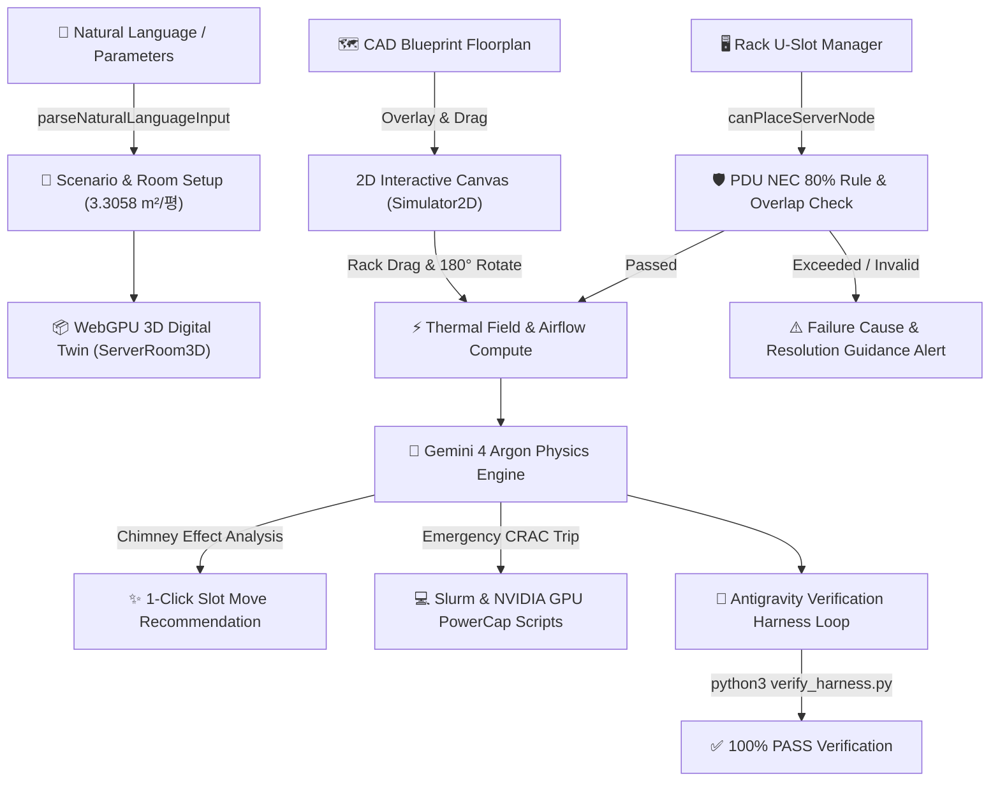

# Data Center Thermal Digital Twin & Gemini 4 Argon WebGPU Engine

> **High-Density GPU Server Room Airflow & Thermal Fluid Simulator & Rack U-Slot 3D Digital Twin**


---

## 📌 Project Overview

**Data Center Thermal Digital Twin** is a hard-tech thermodynamic and spatial simulation platform engineered for AI research labs and data center operators.

To prevent inlet air recirculation and thermal hotspots when operating ultra-high-density GPU servers (NVIDIA H100 SXM5, B200 NVL, A100 HGX, RTX 4090, etc.), this platform integrates real-time **WebGPU WGSL 3D particle airflow tracking**, **isothermal grid volume visualization**, and **Gemini 4 Argon physics optimization engines** into an interactive 3D digital twin.

---

## ✨ Key Capabilities

### 1. 🤖 Natural Language & Parameter AI Configurator
- **Natural Language Parsing**: Generates 3D room spatial layouts and thermal fluid dynamics from English/Korean prompts like `"Deploy 32x H100 SXM5 GPUs in 4 racks for a 60m² server room"`.
- **Flexible Area Unit Conversions**: Automatically recognizes Pyung (`평`), Square Meters (`m²`), and Cubic Meters (`m³`) to scale room dimensions and calculate CRAC cooling requirements.
- **Pre-configured GPU Library**: Built-in support for NVIDIA H100 SXM5 (10.2kW/4U), B200 NVL (14.3kW/4U), A100 HGX (6.5kW/4U), RTX 4090 WS (2.8kW/4U), L40S Inference (3.2kW/2U), and custom node specs.

### 2. 📐 CAD Floor Plan Overlay & Interactive Drag-and-Drop Layout
- **Architectural Blueprint Overlay**: Real-time canvas texture overlay for architectural CAD blueprints (PNG, JPG, SVG) onto 2D/3D floors with opacity, scale, and offset controls.
- **Drag-and-Drop Rack Repositioning**: Click and drag server racks directly on 2D and 3D floor plans.
- **Real-Time Thermal Recalculation**: WebGPU compute engine recalculates airflow and thermal temperature fields instantly upon rack movement.
- **Rack Orientation Control**: Toggle 0° (South) $\leftrightarrow$ 180° (North) rack orientations.

### 3. 🖥️ Interactive 42U/48U Rack U-Slot Manager
- **Front Elevation Inspector**: Displays real-time slot occupancy from U01 to U42 and remaining contiguous free slot ranges.
- **Drag-and-Drop Slot Swapping**: Move and swap server nodes between different racks or staging shelves.
- **Actionable Guidance Alerts**: Outlines specific causes and mitigation steps when slot moves fail due to overlap or PDU capacity limits.

### 4. ⚡ PDU Circuit Breaker NEC 80% Rule & CRAC Heat Balance Verification
- **Continuous Load Monitoring**: Calculates National Electrical Code (NEC) 80% continuous load limits (16A/32A @ 220V/380V).
- **CRAC N+1 Emergency Mode**: Simulates cooling failure and hot weather derating conditions to verify inlet temperature variations.

### 5. 🌊 WebGPU Compute 3D Airflow & Thermal Volume
- **WebGPU WGSL Particle Engine**: Real-time rendering of tens of thousands of 3D airflow particles and isothermal grid volumes.
- **Automatic Fallback Mode**: Gracefully degrades to WebGL2 / CPU rendering in environments without native WebGPU support.

---

## 🏗️ System Architecture & How It Works



### 🔍 Pipeline Breakdown
1. **User Prompt & Input Processing**:
   - The regex engine (`parseNaturalLanguageConfig`) extracts GPU specs, total GPU count, rack count, and room area (`평`, `m²`, `m³`).
   - Converts Pyeong to spatial dimensions ($1\text{평} = 3.305785\,\text{m}^2 \implies W = \sqrt{2A}, D = W/2, H = 3.0\text{m}$).
2. **Thermal & Airflow Physics Engine**:
   - Uses Gauss-Seidel Poisson solver for potential flow airflow tracking ($Q = \rho C_p V \Delta T$).
   - Computes vertical chimney stratification ($\Delta T_{\text{chimney}} = h \cdot 4.2^\circ\text{C}$) for each U-slot in 42U racks.
3. **Closed-Loop Safety Guardrails**:
   - Evaluates National Electrical Code (NEC) 80% continuous breaker limit ($V \cdot I \cdot 0.80$).
   - Rejects invalid slot placements with detailed failure cause and actionable step-by-step resolution instructions.
4. **Gemini 4 Argon Long-Horizon Verification**:
   - Analyzes thermal plume distribution and generates 1-Click slot move recommendations.
   - Evaluates 9-case perturbation sensitivity matrix in the Antigravity sandbox (`python3 verify_harness.py`).

---

## 🛠️ Tech Stack

| Category | Technology / Library |
| :--- | :--- |
| **Frontend UI** | React 18, TypeScript, Vite, Tailwind CSS, Lucide Icons |
| **3D / Compute Engine** | Three.js (`WebGPURenderer`), WGSL (WebGPU Shading Language), WebGL2 |
| **Physics & Thermal** | Gauss-Seidel Poisson Solver, Potential Flow, Advection-Diffusion |
| **Backend Runtime** | Node.js Express API (`/api/health`, `/api/argon/analyze`) |
| **Container & Cloud** | Docker, Google Cloud Run |

---

## 🚀 Getting Started

### 1. Prerequisites
- **Node.js**: v18.0.0 or higher (Node.js 22 recommended)
- **Docker** (optional, for Cloud Run deployment)

### 2. Install Dependencies
```bash
npm install
```

### 3. Run Local Development Server
```bash
npm run dev
```
Open `http://localhost:5173` in your browser.

### 4. Build for Production
```bash
npm run build
```

---

## ☁️ Google Cloud Run Deployment

To deploy this containerized digital twin on Google Cloud Run:

```bash
gcloud run deploy data-center-twin \
  --source . \
  --platform managed \
  --region asia-northeast3 \
  --allow-unauthenticated \
  --set-env-vars NODE_ENV=production,GEMINI_API_KEY="YOUR_GEMINI_API_KEY"
```

---

## 📊 Benchmark Simulation Presets

- **Preset A (Standard Open Layout - Same Direction)**: Uncontained hot/cold aisles, peak inlet temperature 35.5°C (6/24 racks overheated).
- **Preset B (Hot/Cold Aisle Containment)**: Sealed aisle containment, peak inlet temperature 22.1°C (0/24 racks overheated).
- **Preset C (N+1 Emergency CRAC Failure)**: Single CRAC outage simulation, peak inlet temperature 29.6°C (4/24 racks overheated).

---

## 📝 License

Data Center Thermal Digital Twin Engine &copy; 2026. All Rights Reserved.
